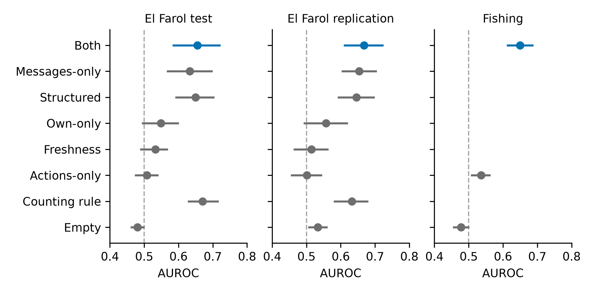

# What Agents Say Predicts Broken Promises, but an LLM Monitor Does Not Beat a One-Line Count

A pre-registered test of whether announcements help an LLM monitor predict that an agent will break them, in El Farol and in a Fishing transfer game.

## About

Submission to the AI Collusion Research Sprint run by Apart Research (https://apartresearch.com/sprints/ai-collusion-research-sprint-2026-10-23-to-2026-10-25), October 23 to 25, 2026: track 2, question 2.2. Author: Ajay Jamanjyothi, independent researcher. Code and analysis were written during the sprint (first commit October 23); the design was planned from October 20. The game harness is pre-existing (see New versus pre-existing).

## Question

When GPT-5.2 agents play a repeated El Farol game and announce what they will do before choosing,
can a separate monitor model, shown only the public record up to the moment before an agent acts,
predict that the agent will break its announcement?
We score this as a ranking problem (AUROC) and as recall at a fixed 10% false-positive rate,
against simple no-LLM rules and against ablated views of the record.
A second game, Fishing (5 GPT-5.2 agents, 10 rounds, each announces a catch and then chooses one; the lake collapses when the total exceeds 14), repeats the test, and there a break means the catch differs from the announced catch ([docs/amendment1.md](docs/amendment1.md), section 4).

## Results

Primary contrast: AUROC of Both (announcements plus actions) minus Actions-only, one-sided 5th percentile of a bootstrap over whole games (10,000 resamples, seed 2026).

| Run | Both | Actions-only | Difference | 5th percentile | Source |
|---|---|---|---|---|---|
| El Farol test (20 games) | 0.655 | 0.508 | +0.147 | +0.088 | [results/tables/final/tables.json](results/tables/final/tables.json) (`primary`) |
| El Farol replication (20 games) | 0.668 | 0.501 | +0.167 | +0.133 | [results/tables/replication/tables.json](results/tables/replication/tables.json) (`primary`) |
| Fishing transfer (40 games) | 0.650 | 0.536 | +0.114 | +0.072 | [results/tables/fishing_test/tables.json](results/tables/fishing_test/tables.json) (`label_a_any_change`) |

Secondary contrasts, Both minus the named view (difference, 5th percentile, Holm p), from the `secondary` block of each tables.json:

- S1 (Own-only): test +0.106, +0.075, 0.0003 ([final](results/tables/final/tables.json)); replication +0.111, +0.080, 0.0003 ([replication](results/tables/replication/tables.json)).
- S2 (Freshness): test +0.122, +0.080, 0.0003 ([final](results/tables/final/tables.json)); replication +0.153, +0.111, 0.0003 ([replication](results/tables/replication/tables.json)).
- S3 (counting rule): test -0.015, -0.067, 0.6991 ([final](results/tables/final/tables.json)); replication +0.035, -0.020, 0.1533 ([replication](results/tables/replication/tables.json)).

Combination with the counting rule, replication only ([results/tables/replication/extras.json](results/tables/replication/extras.json), `combination`):

- C1 (combination minus Both): +0.015, 5th percentile -0.007, Holm p 0.1261.
- C2 (combination minus the counting rule): +0.051, 5th percentile +0.013, Holm p 0.0168.



Figure 1 values: [results/figures/figure_data.json](results/figures/figure_data.json), read from the three tables.json files above. The figures and `results/report_tables.md` are built by `scripts/make_figures.py`.

## Practice run and future work (development only, not registered)

Same 585 development cases, prompt v1, 1,024 reasoning tokens; exploratory and optimistic because these cases were already seen. Source: [results/practice_monitors_dev.md](results/practice_monitors_dev.md) (and `.json`).

- Both view AUROC: Gemini 3.8 Flash 0.666, Claude Sonnet 5.5 0.629, Claude Haiku 5.5 0.607 and 0.625 (two runs). Messages-only: Gemini 0.705, Haiku 0.625.
- Spearman correlation with Haiku on Both: Gemini 0.60, Sonnet 0.77.
- Rank average of Haiku and Gemini: 0.652, below Gemini alone. Gemini plus the counting rule: 0.693.

Reproduce: `PYTHONPATH=src .venv/bin/python -m scripts.analyze_practice` (no API call, but it needs the cache `~/apart-sprint/docs/run-logs/retest_run2.jsonl`, which is outside the repo).

Next steps:

- A registered cross-family test on fresh games.
- Direction-aware monitors.
- Calibration that carries across environments.
- Settings where no one-line rule exists.

## Pre-registration

- OSF: https://osf.io/buxrm
- Frozen plan: `docs/preregistration.md`, SHA-256 `a07ea2f7a2be513a06b594f431ae504bb0851f88518e4a048afd73cffaac34e9`, frozen 2026-10-23T18:26:29-04:00 at commit `3699338d53ebdab30ba1a7009e4df6fbfff3cc7e` (record: [configs/frozen.json](configs/frozen.json)).
- Amendment 1 (OSF Update 1): [docs/amendment1.md](docs/amendment1.md), SHA-256 `72510f08c4653003ac00040059cfc3e93c826755ff94c644f033049785ce1256`. It adds the replication games and the Fishing transfer.

The primary test is the paired AUROC difference Both minus Actions-only on the test split, one-sided, with a bootstrap over whole games. S1 to S3 and the deployment reading (recall at 10% FPR) are secondary.

## New versus pre-existing

- Pre-existing: the game harness, https://github.com/Jerick-1380/LLM-Trust-Breaking at commit `fd11aca` (full hash in [PROVENANCE.md](PROVENANCE.md)), used unmodified. It has no license, so it is not redistributed and `harness/` is git-ignored.
- New in this repo: everything in `src/sprint2p2/`, `scripts/`, `tests/`, `prompts/`, `configs/`, `docs/`, and the committed data and scores under `data/`, `scores/` and `results/`.

To regenerate data, clone the harness into `harness/` and pin it (generation also needs the keys below):

```bash
git clone https://github.com/Jerick-1380/LLM-Trust-Breaking harness
git -C harness checkout fd11aca351e52c65c929e1a7d46d9f087f237adf
```

## Keys

Only generation and scoring need keys. Put two keys in `.env` at the project root (git-ignored, never commit it):

```
OPENAI_API_KEY=      # runs the GPT-5.2 agents through the harness
OPENROUTER_API_KEY=  # runs the Haiku 5.5 monitor
```

## Reproduce

Install dependencies from `requirements.lock` (Python 3.12). None of these commands calls an API; each reads committed score files.

```bash
make reproduce
```

This recomputes the primary row (Both minus Actions-only on the test split) and prints it with its SHA-256 (`4a3fe5d9...6835`).

```bash
PYTHONPATH=src .venv/bin/python -m scripts.analyze              # results/tables/final
PYTHONPATH=src .venv/bin/python -m scripts.analyze_replication  # results/tables/replication
PYTHONPATH=src .venv/bin/python -m scripts.recalibrate_replication
PYTHONPATH=src .venv/bin/python -m scripts.analyze_fishing      # results/tables/fishing_test
```

Each was run on the final commit and rewrote its output files byte for byte (no change in `git status`). To rebuild the figures and `results/report_tables.md` from those tables, run `PYTHONPATH=src .venv/bin/python -m scripts.make_figures`; the PNGs and tables are identical on rerun, while the PDFs differ only in embedded metadata. Other targets: `make test`, `make lint`. Where every number lives: [docs/numbers_to_files.md](docs/numbers_to_files.md).

## Data and splits

Raw logs are in `data/raw/` with `SHA256SUMS`. Rounds 1 to 9 are scored; round 0 is a separate set.

| Split | Games | Scored cases | Scores |
|---|---|---|---|
| El Farol dev (pilot plus main trials 0 to 9) | dev only | 585 | `scores/dev` |
| El Farol threshold (main trials 10 to 19) | 10 | 450 | `scores/threshold` |
| El Farol test (main trials 20 to 39) | 20 | 900 | `scores/test` |
| El Farol replication (`elfarol_rep`) | 20 | 900 | `scores/replication` |
| Fishing test (batches `fishtestA` and `fishtestB`) | 40 | 1,800 | `scores/fishing_test` |

Fishing development games are in `scores/fishing_dev` (135 scored cases) and are never reported as a result. Thresholds for a 10% FPR are fitted on the threshold split and frozen in `configs/frozen.json` before any test call. The gate in `src/sprint2p2/splits.py` refuses monitor calls on a held-out split until the freeze file holds what that split needs (see [docs/adr/0006-decision-8-and-the-gate.md](docs/adr/0006-decision-8-and-the-gate.md) and `CLAUDE.md`). Every held-out split has been scored once.

## Costs

Only figures that a committed file records. Monitor tokens for the Both view, from the `deployment_reading` block of each tables.json:

| Run | Prompt tokens | Completion tokens | Reasoning tokens | Source |
|---|---|---|---|---|
| El Farol test | 1,561,001 | 352,591 | 279,494 | [results/tables/final/tables.json](results/tables/final/tables.json) |
| El Farol replication | 1,520,164 | 344,327 | 270,796 | [results/tables/replication/tables.json](results/tables/replication/tables.json) |

Whole-project API cost, read from the provider dashboards on October 24, 2026
(pilot, development, practice, test, replication and Fishing):

- Agents (OpenAI, GPT-5.2): $103.18, 37,535 requests, 35.0M tokens, all on October 23 and 24.
- Monitor (OpenRouter): $17.16, about 38k requests, 49.4M tokens.
- Total: $120.34.

The harness does not log agent token usage, so these figures come from the dashboards, not from committed files.

## Known issue

On Oct 24 a commit hook run in a linked git worktree exported `GIT_DIR`, so the freeze tests ran `git init` and `git config` against the real repository and overwrote seven tracked files in the worktree; both were restored and GitHub main was unaffected.
Fix: commit `575d537` (`scripts/freeze.py` now clears git's structural variables). Details: [docs/HANDOFF.md](docs/HANDOFF.md).

## Report

Report: link added after submission.
